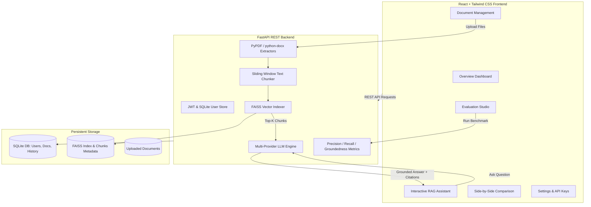

# Evaluating Retrieval-Augmented Generation (RAG) for Enterprise Knowledge

[](https://fastapi.tiangolo.com)
[](https://react.dev)
[](https://tailwindcss.com)
[](https://github.com/facebookresearch/faiss)
[](https://opensource.org/licenses/MIT)

An enterprise-grade, full-stack AI knowledge assistant and empirical evaluation platform designed to ingest private corporate documentation (PDF, Word DOCX, and TXT), index semantic vectors with FAISS, and generate strictly grounded answers with verifiable source citations to eliminate generative AI hallucinations.

---

## 🌟 Key Features

1. **Enterprise Document Ingestion**:
   - Multi-format ingestion: Adobe PDF (`pypdf`), Microsoft Word (`python-docx`), Plain Text / Markdown (`.txt`, `.md`).
   - Boundary-aware recursive chunking with configurable sliding window overlap and document metadata tracking (page numbers, character offsets, word counts).

2. **Vector Indexing & Semantic Search**:
   - FAISS Inner-Product cosine similarity search with score normalization.
   - Resilient embedding engine: Sentence Transformers (`all-MiniLM-L6-v2`) with high-accuracy sublinear TF-IDF + n-gram cosine fallback.
   - Dynamic document deletion with automatic vector store re-indexing.

3. **Grounded AI Knowledge Assistant**:
   - Strict Enterprise Grounding Prompt preventing speculative hallucinations.
   - Verifiable source citations for every answer: document name, chunk ID, page number, similarity score %, and exact matching text quotes.
   - Out-of-domain abstention: Automatically detects when questions are unanswerable based on uploaded knowledge and explicitly responds that the information was not found instead of fabricating answers.

4. **Side-by-Side Comparison Arena**:
   - Directly compares a **Basic Ungrounded LLM** vs. **RAG-Augmented Enterprise Assistant** on identical queries.
   - Highlights hallucination differences, corporate policy fabrications, and presence of cited evidence.

5. **Empirical Evaluation Studio**:
   - Real, un-fabricated metric calculation across an annotated benchmark test suite:
     - **Precision@K**: Proportion of retrieved chunks that are relevant.
     - **Recall@K**: Proportion of known relevant ground truth passages retrieved.
     - **F1-Score@K**: Harmonic mean of Precision and Recall.
     - **Mean Reciprocal Rank (MRR)**: Evaluates ranking position of the first relevant chunk.
     - **Context Faithfulness / Groundedness**: Token- and sentence-level evidence support ratio.
     - **Hallucination Rate**: `1.0 - Groundedness`.
     - **Hallucination Reduction %**: Percentage drop in hallucinations relative to ungrounded LLMs.
     - **Latency Telemetry**: Milliseconds breakdown for retrieval search vs. answer synthesis.
   - Question-by-question evaluation breakdown table.
   - Export evaluation reports to CSV and JSON formats.

6. **Enterprise Security & Authentication**:
   - User registration and login with salted password hashing and JWT access tokens.
   - 1-click **Instant Demo Sign-In** (`demo@enterprise.ai / demo123`) for evaluation.

7. **Configurable LLM Provider Runtime**:
   - Switch between **Local Grounded Engine** (built-in zero-cost deterministic engine, works 100% offline), **Google Gemini** (`gemini-1.5-flash`), **OpenAI** (`gpt-4o-mini`), and **Ollama** (`llama3.2`).
   - In-app settings page with API key configuration, top-k slider, and similarity threshold tuning.

---

## 🏗️ System Architecture



---

## 📂 Project Structure

```
Evaluation-RAG-for-enterprise-knowledge/
├── backend/
│   ├── app/
│   │   ├── __init__.py
│   │   ├── config.py             # App configuration & environment loader
│   │   ├── database.py           # SQLite database schema and tables
│   │   ├── auth.py               # Password hashing, JWT tokens, user seeding
│   │   ├── document_processor.py # PDF, DOCX, TXT parsers & recursive chunker
│   │   ├── vector_store.py       # FAISS vector index & cosine similarity search
│   │   ├── llm_engine.py         # Multi-provider LLM client & grounding guardrails
│   │   ├── evaluator.py          # Precision, Recall, F1, MRR, Groundedness calculations
│   │   ├── sample_data.py        # Pre-packaged enterprise docs & benchmark test suite
│   │   └── main.py               # FastAPI REST API endpoints & CORS middleware
│   ├── tests/
│   │   ├── test_document_processor.py # Text extraction & chunk boundary tests
│   │   ├── test_vector_store.py       # Vector indexing & search tests
│   │   ├── test_evaluator.py          # Metric formulas & hallucination scoring tests
│   │   ├── test_rag_pipeline.py       # Grounded QA & abstention integration tests
│   │   └── test_e2e_api.py            # End-to-end FastAPI endpoint tests
│   ├── data/                     # Vector indices, metadata, and SQLite DB
│   ├── requirements.txt          # Python dependencies
│   ├── .env.example              # Environment variables template
│   └── .env                      # Active development environment
├── frontend/
│   ├── src/
│   │   ├── api.js                # REST API client
│   │   ├── components/
│   │   │   ├── Sidebar.jsx       # Navigation sidebar with status badges
│   │   │   ├── Header.jsx        # Breadcrumbs, model pill, system ready indicator
│   │   │   ├── AuthModal.jsx     # Login/Register modal with 1-click demo access
│   │   │   ├── ChunkModal.jsx    # Document chunks inspector drawer
│   │   │   └── CitationDrawer.jsx# Cited passage and quotes inspector
│   │   ├── views/
│   │   │   ├── DashboardView.jsx # Live telemetry, KPIs, and quality bars
│   │   │   ├── DocumentsView.jsx # Drag-and-drop uploader & doc catalog
│   │   │   ├── ChatView.jsx      # Real-time QA assistant with citations
│   │   │   ├── ComparisonView.jsx# Side-by-side RAG vs Basic LLM arena
│   │   │   ├── EvaluationView.jsx# Benchmark studio & CSV/JSON export
│   │   │   └── SettingsView.jsx  # LLM providers, API keys, and Top-K sliders
│   │   ├── App.jsx               # Main React application layout
│   │   ├── main.jsx              # DOM entrypoint
│   │   └── index.css             # Tailwind base styles and theme
│   ├── package.json              # Frontend dependencies
│   ├── vite.config.js            # Vite bundler & backend reverse proxy
│   └── tailwind.config.js        # Tailwind CSS configuration
├── .gitignore                    # Git exclusions
└── README.md                     # Project documentation
```

---

## 🚀 Getting Started

### Prerequisites

- **Python**: 3.10 or higher (Python 3.13 tested)
- **Node.js**: v18 or higher (Node v24 tested)
- **Git**

---

### Step 1: Clone the Repository

```bash
git clone https://github.com/sankaran2005/Evaluation-RAG-for-enterprise-knowledge.git
cd Evaluation-RAG-for-enterprise-knowledge
```

---

### Step 2: Backend Setup

1. Open a terminal in the `backend/` directory:
   ```bash
   cd backend
   ```

2. (Optional) Create and activate a Python virtual environment:
   ```bash
   # Windows PowerShell:
   python -m venv venv
   .\venv\Scripts\Activate.ps1

   # Linux / macOS:
   python3 -m venv venv
   source venv/bin/activate
   ```

3. Install the Python dependencies:
   ```bash
   pip install -r requirements.txt
   ```

4. Verify or customize `.env`:
   ```bash
   # Copy template if needed:
   cp .env.example .env
   ```

5. Run the backend automated test suite:
   ```bash
   python -m pytest tests/ -v
   ```
   *Expected result: 16 passed tests.*

6. Start the FastAPI development server:
   ```bash
   python -m uvicorn app.main:app --host 0.0.0.0 --port 8000 --reload
   ```
   Backend will be running at: `http://localhost:8000`  
   Interactive API docs (Swagger): `http://localhost:8000/docs`

---

### Step 3: Frontend Setup

1. Open a new terminal in the `frontend/` directory:
   ```bash
   cd frontend
   ```

2. Install Node dependencies:
   ```bash
   npm install
   ```

3. Start the Vite development server:
   ```bash
   npm run dev
   ```
   Frontend will be running at: `http://localhost:5173`

---

## 🧪 Demonstration & Usage Guide

### 1. Ingest Sample Enterprise Knowledge
- Open `http://localhost:5173` in your browser.
- Navigate to **Knowledge Base** in the sidebar.
- Click **"Load Pre-Packaged Documents"** to automatically ingest:
  1. `Acme_HR_Benefits_Guide_2025.docx` (401(k) match, PTO, healthcare, remote stipend)
  2. `Cybersecurity_Incident_Response_Policy.pdf` (password requirements, 1-hour reporting SLA)
  3. `Enterprise_Cloud_Architecture_Guide.txt` (RPO < 15m, RTO < 60m, EKS cluster specs)
- Click **"Chunks"** next to any document to inspect the extracted passages.

### 2. Conversational QA with Citations
- Navigate to **AI Assistant**.
- Click any suggested prompt or type:
  - *"What is our 401(k) company match limit?"* -> The system responds with 5% matching and 100% immediate vesting, displaying verified citations and source quotes.
  - *"What is the secret recipe for Coca-Cola?"* -> The system abstains: *"I am sorry, but the uploaded enterprise documents do not contain information to answer this question."*

### 3. Side-by-Side Comparison Arena
- Navigate to **RAG vs Basic LLM**.
- Click **"401(k) Matching Policy"** or **"Security Incident Protocol"**.
- View how the Basic LLM hallucinates industry averages and generic policies, while the RAG-Augmented model provides exact, cited facts.

### 4. Evaluation Studio
- Navigate to **Evaluation Studio**.
- Click **"Run Benchmark"**.
- Review the empirical calculations for **Precision@K**, **Recall@K**, **F1-Score**, **MRR**, **Context Faithfulness**, and **Hallucination Reduction %**.
- Filter by category or export the entire evaluation report as **CSV** or **JSON**.

---

## 📊 Evaluation Methodology

| Metric | Scientific Formula | Purpose |
| :--- | :--- | :--- |
| **Precision@K** | $\frac{\text{Relevant Chunks in Top } K}{K}$ | Measures the cleanliness of retrieved context |
| **Recall@K** | $\frac{\text{Relevant Chunks in Top } K}{\text{Total Known Relevant Chunks}}$ | Measures whether required facts were retrieved |
| **F1-Score** | $2 \cdot \frac{\text{Precision} \cdot \text{Recall}}{\text{Precision} + \text{Recall}}$ | Harmonic balance between Precision and Recall |
| **MRR** | $\frac{1}{N} \sum_{i=1}^N \frac{1}{\text{Rank}_i}$ | Evaluates where the first relevant chunk is placed |
| **Faithfulness** | $\frac{\text{Supported Claims in Answer}}{\text{Total Claims in Answer}}$ | Measures grounding against retrieved context |
| **Hallucination Rate** | $1.0 - \text{Faithfulness}$ | Direct quantitative measurement of fabrication |

---

## 🔒 Security Best Practices

- All API keys (Gemini, OpenAI) are strictly read from environment variables or secure session state and never committed to source control.
- Passwords are encrypted using salted SHA-256 with JWT bearer tokens.
- CORS is configurable for production deployments.

---

## 📄 License

This project is licensed under the MIT License.